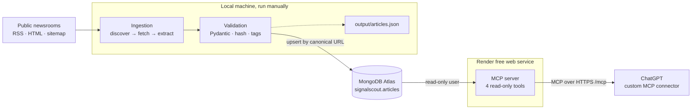

# SignalScout

SignalScout collects public news from healthcare organizations' newsrooms, stores it as validated documents
in MongoDB Atlas, and makes it searchable by AI assistants through a read-only MCP server deployed on Render.

## 1. Overview

**The problem.** Teams that sell to or partner with organizations follow what those organizations announce:
partnerships, technology adoption, acquisitions, expansions, investments and leadership changes. That news
is spread across many newsrooms with different layouts, and an AI assistant cannot reliably answer "what has
this organization announced recently?" without a current, citable source of data.

**What SignalScout does.**

1. Discovers recent articles on configured newsrooms (RSS feeds, HTML listing pages, XML sitemaps).
2. Fetches each page politely and extracts its title, text and metadata with site-independent tools.
3. Validates every article against one Pydantic schema and stores it in MongoDB Atlas, keyed by canonical
   URL, so repeated runs never create duplicates.
4. Serves the data through an MCP server with four read-only tools, so an assistant such as ChatGPT can
   search the articles and cite the original sources.

**Why MCP.** The Model Context Protocol is a standard way for AI assistants to call external tools. Exposing
the database as MCP tools lets the assistant work from retrieved facts (titles, dates, excerpts, source URLs)
instead of its training data, and the same server works with any client that supports remote MCP servers.
The server only retrieves data; summarising and reasoning stay with the assistant.

**How it is used.** After adding the server as a connector in ChatGPT, you ask questions in plain language
and ChatGPT calls the tools, for example:

- "Which healthcare organizations announced partnerships recently? Cite the sources."
- "What has Cleveland Clinic announced in the last month?"
- "Find news about AI adoption at these health systems."
- "What does the SignalScout database cover, and how recent is it?"

Healthcare newsrooms are the demonstration dataset; the code is not healthcare-specific, and adding a website
means adding an entry to `sources.json`. This is a student portfolio project, built with plain synchronous
Python and a handful of modules.

## 2. Architecture and Tech Stack



The two halves meet only in the database. Ingestion runs locally with a read-write database user; the MCP
server runs on Render with a separate read-only user and never runs ingestion.

| Technology | Purpose |
|---|---|
| Python 3.10 (local), 3.12 (Render) | Synchronous Python throughout |
| requests | HTTP fetching with timeouts, limited retries and an honest bot User-Agent |
| feedparser | Reading RSS feeds |
| BeautifulSoup, lxml | HTML listing pages, XML sitemaps, canonical URL, language and per-site clean-up |
| Trafilatura | Generic extraction of the main article text and metadata (JSON-LD, Open Graph, meta tags) |
| Pydantic | The common article schema and its validation |
| MongoDB Atlas, PyMongo | Storage, unique URL index, date and source indexes, text search |
| MCP Python SDK 2.3 (Starlette, Uvicorn) | The MCP server over Streamable HTTP |
| Render | Hosting the MCP server (free web service) |
| pytest | Offline unit tests and opt-in MongoDB Atlas integration tests |
| ChatGPT | MCP client used for end-to-end testing |

## 3. Features and Implementation

### Supported websites

| Organization | Discovery method | Notes | Articles* |
|---|---|---|---|
| Cleveland Clinic | HTML listing page | No RSS feed; robots.txt asks for a 10 s crawl delay | 10 |
| Stanford Medicine | HTML listing page + CSS selector | The full news list is built by JavaScript; `news.html` has a server-rendered list | 8 |
| Mass General Brigham | XML sitemap | Listing built by JavaScript; publication date read from `articlepublishdate` | 21 |
| Intermountain Health | RSS feed | 5 s crawl delay | 20 |
| Vanderbilt University Medical Center | RSS feed | | 20 |

\* Verified snapshot, 2026-11-25.

Three other candidates (Mayo Clinic, Johns Hopkins Medicine, UNC Health) block automated access with HTTP 403
responses or bot challenges. They stay in `sources.json` as disabled entries with notes; the blocks were not
bypassed.

### Discovery and fetching

- `discover.py` turns each source's start page into article URLs: RSS entries, links on an HTML listing page
  (optionally narrowed by a CSS selector and URL pattern), or sitemap entries ordered by newest `lastmod`.
  Links are normalized, restricted to the source's domains, de-duplicated and limited per source (default 20).
- `web.py` is the only code that downloads pages. It checks robots.txt, waits between requests to the same
  host (2 s, or the site's Crawl-delay if longer), retries timeouts, HTTP 429 and 5xx at most twice while
  honouring Retry-After, and never retries 403 or 404.

### Extraction and validation

- Trafilatura extracts the main text and metadata; BeautifulSoup reads the canonical URL and language and
  applies optional per-site `remove_selectors` for boilerplate such as disclaimers or contact boxes. Empty
  pages, bot-check pages and stubs under 300 characters are rejected.
- Missing dates, authors or descriptions are stored as `null`; nothing is guessed.
- `models.py` validates every article with Pydantic (canonical URL, source, title and content are required)
  and adds an excerpt, a SHA-256 content hash, and keyword tags (`ai`, `automation`, `partnership`,
  `expansion`, `investment`, `acquisition`, `leadership`, `research`) computed from the headline, description
  and lead.
- The sites' terms of use restrict republishing, so SignalScout stores the title, the site's own description,
  a short excerpt (about 500 characters) and the source URL (`content_scope: "excerpt"`). The full text is used
  only in memory, for the content hash and the tags.

### Deduplication and storage

- An article's identity is its normalized canonical URL (fragments and tracking parameters removed), enforced
  by a unique index. Each article is saved with one `update_one(..., upsert=True)`:
  - a new URL is inserted with `first_seen_at`, `last_fetched_at` and `last_updated_at`;
  - a changed content hash updates the article and keeps `first_seen_at`;
  - unchanged content only moves `last_fetched_at`.
- Empty values never overwrite stored data, and nothing is deleted automatically.
- Indexes: unique `canonical_url`, `published_date`, `source.id`, and a weighted text index over title,
  description and excerpt.

### Retrieval and the MCP tools

`server.py` uses the official MCP Python SDK and serves Streamable HTTP at `/mcp` (stateless, JSON responses),
plus a `/health` endpoint for Render. Its four tools are read-only:

| Tool | Returns |
|---|---|
| `search_articles(query, limit=10)` | Articles matching keywords or a topic: MongoDB text search combined with tag matching and simple synonyms (AI / artificial intelligence, expansion / expand, partnership / joint venture, acquisition / merger, investment / funding). Each result says whether it matched by text, tags or both. |
| `get_organization_news(organization, limit=10)` | One organization's newest articles. Accepts names, source ids or initials in any case; an unknown name returns the list of available organizations. |
| `get_recent_articles(days=30, limit=10)` | Articles published in the last N days, by publication date; undated articles are excluded. |
| `get_data_coverage()` | Article totals, per-organization counts and date ranges, the latest fetch time, and a statement of the data's limits. |

Every article is returned with its title, organization, publication date, description, excerpt, content
scope, tags and source URL; MongoDB ids and internal fields are never returned.

The server is defensive by design. Inputs are validated (limit 1–20, days 1–365, queries up to 200
characters), and user text is reduced to plain keywords, so it never becomes a MongoDB query. Every database
query has a 5-second limit. The tools only read and carry MCP's `readOnlyHint`. On `/mcp`, the server accepts
only requests addressed to its own hostname, and every response labels web content as untrusted data.

### The publication-date bug

Comparing stored dates with each source showed that Mass General Brigham dates were wrong. The page's
`published-time` tag records when the page was last re-published in the site's CMS, not when the article
was written: an article written on 2026-05-20 carried 2026-09-03. Of the 17 stored MGB articles with an
`articlepublishdate` tag, 12 had a later date. The fix is a per-source `date_meta` setting that reads
`articlepublishdate` and leaves the date `null` when that tag is missing. The affected dates were reset once
and re-ingested; afterwards every MGB date matched `articlepublishdate`. Dates for the other sources match
the dates in their URLs (Cleveland Clinic 10/10, Vanderbilt 20/20, Stanford 8/8).

## 4. Results

Verified snapshot of the database, tests and deployment (2026-11-24 to 2026-11-25):

| Metric | Result |
|---|---|
| Articles stored | 79 unique articles from 5 healthcare organizations |
| Discovery methods | 3 (RSS, HTML listing page, XML sitemap) |
| Duplicate canonical URLs | 0 (79 documents, 79 distinct URLs, after repeated ingestion runs) |
| Tests | 78 passing (75 offline + 3 against MongoDB Atlas) |
| Deployed MCP tools | 4, verified on Render with an MCP client and through ChatGPT |
| Warm remote response time | 150–320 ms per tool call, measured from an external client |
| Publication dates | 76 of 79 articles dated; the 3 undated MGB pages declare no publication date |

Search results returned per query (limit 20), with plain MongoDB text search compared to the `search_articles`
tool (text search plus tags and synonyms):

| Query | Text search only | `search_articles` |
|---|---|---|
| AI | 0 | 2 |
| artificial intelligence | 1 | 2 |
| expansion | 0 | 15 |
| partnership | 3 | 7 |
| investment | 3 | 11 |
| acquisition | 1 | 2 |
| automation | 0 | 0 |

These counts measure retrieval coverage (how many stored articles each method returns), not accuracy. Tags
come from keyword rules and can include loosely related articles, and no relevance judgments were collected.

## 5. Installation and Usage

Requirements: Python 3.10 or newer and a MongoDB Atlas cluster (the free tier is enough).

```bash
git clone https://github.com/<your-username>/signalscout.git
cd signalscout
python -m pip install -r requirements.txt
```

### Configure MongoDB

```bash
cp .env.example .env      # set MONGODB_URI to your Atlas connection string
python test_connection.py # prints only whether the connection works
```

Add your IP address to the Atlas IP Access List. `.env` is gitignored and must never be committed.

### Run ingestion

```bash
python ingest.py --dry-run --limit 5                  # discover, extract and validate; write output/articles.json only
python ingest.py --source cleveland_clinic --dry-run  # one source
python ingest.py                                      # full run: up to 20 articles per source into MongoDB
python ingest.py --from-json output/articles.json     # load a saved export, e.g. after a database outage
```

Ingestion is triggered manually. A full run takes about six minutes because of the sites' crawl delays and
ends with a summary of inserted, updated and unchanged articles. The MCP server reads MongoDB on every call,
so new articles are available immediately; Render only needs a redeploy when the server code changes.

### Search from the command line

```bash
python search.py "artificial intelligence"   # plain MongoDB text search
python search.py --stats                     # articles per source
```

### Run the MCP server locally

```bash
python server.py      # MCP endpoint http://localhost:8000/mcp, health check http://localhost:8000/health
python check_mcp.py   # in a second terminal: lists and calls all four tools
```

### Run the tests

```bash
python -m pytest -v                          # 75 offline tests; the 3 Atlas tests are skipped
SIGNALSCOUT_DB_TESTS=1 python -m pytest -v   # all 78; needs MONGODB_URI
```

The Atlas tests only read the article collection; one of them writes to a temporary `articles_test`
collection and drops it.

### Deploy to Render

1. In Atlas, create a read-only database user: Database Users → Add New Database User → Specific Privileges
   → role `read` on database `signalscout`.
2. Create a Render web service from the repository:

   | Setting | Value |
   |---|---|
   | Runtime | Python (3.12, from `.python-version`) |
   | Build command | `pip install -r requirements.txt` |
   | Start command | `python server.py` |
   | Health check path | `/health` |
   | Environment variable | `MONGODB_URI` = the read-only user's connection string, without quotes |
   | Instance type | Free |

3. In Render, open the service → Connect → Outbound, and add those IP ranges to the Atlas IP Access List.
4. Verify the deployment:

   ```bash
   curl https://<your-service>.onrender.com/health
   python check_mcp.py https://<your-service>.onrender.com/mcp
   ```

Render sets `PORT` and `RENDER_EXTERNAL_HOSTNAME` automatically: the server listens on `PORT` and accepts MCP
requests addressed to that hostname. Render never runs `ingest.py`.

### Connect ChatGPT

Following OpenAI's "Add custom MCP server" guide (ChatGPT on the web; menu names change over time):

1. Open Plugins (`chatgpt.com/plugins`), select **+**, then **Add custom MCP server**.
2. Name it `SignalScout` and enter the server URL `https://<your-service>.onrender.com/mcp`.
3. Choose **No authentication**, confirm the warning, and create and install the plugin.
4. In a chat, type `@`, select SignalScout, and ask a question.

Because the tools carry `readOnlyHint`, ChatGPT treats them as read actions. After changing the tools on the
server, refresh the app in ChatGPT's settings to reload them.

## 6. Demo

Screenshots and a demo video will be added here.

<!-- Save screenshots in docs/images/ and remove the comment markers around each image. -->

<!--  -->

<!--  -->

<!--  -->

<!--  -->

<!--  -->

<!-- Demo video: [Watch the demo](https://example.com/signalscout-demo) -->

## 7. Limitations and Future Improvements

### Limitations

- **Limited coverage.** 79 articles from 5 healthcare newsrooms, collected since 2026-11-24. Answers can only
  reflect this data.
- **Manual refresh.** Ingestion runs only when started by hand, so the data is as current as the last run.
- **Incomplete history.** Each run sees only the newest items per newsroom (about 8 to 25, no pagination), so
  older articles and articles published during long gaps between runs are missed.
- **Website changes.** Discovery and clean-up depend on each site's current structure (for example Stanford's
  CSS selector); a redesign can stop discovery for a source, which the run logs as a warning.
- **Excerpt-based storage.** Only short excerpts are stored, so search covers titles, descriptions and
  excerpts, not full articles.
- **Basic retrieval.** Keyword search with heuristic tags and a small synonym table; no semantic
  understanding, and a query with several topics matches articles with any of them.
- **Imperfect metadata.** 3 articles have no publication date; dates are taken as the page writes them (one
  Intermountain article is a day off because of a timezone offset in its metadata); some sites list the
  organization itself as the author.
- **Free-tier cold starts.** The Render service sleeps after 15 minutes without traffic and needs about a
  minute to wake, so the first request after a pause is slow.
- **Unauthenticated endpoint.** The MCP server has no user authentication; anyone with the URL can call the
  read-only tools. This is acceptable here only because it serves public, permitted excerpts through a
  read-only database user.

### Possible improvements (not implemented)

- Scheduled ingestion (for example cron or a hosted scheduled job) with alerts for failed runs.
- More sources and industries, and pagination for deeper history.
- Semantic search with embeddings alongside keyword search, and entity extraction for organizations.
- Authentication and rate limiting for the MCP endpoint.

## 8. Project Structure

```text
signalscout/
├── sources.json          # per-website configuration (5 enabled, 3 disabled with reasons)
├── web.py                # polite HTTP fetching, robots.txt, URL normalization
├── discover.py           # RSS, HTML listing and sitemap discovery
├── extract.py            # Trafilatura + BeautifulSoup extraction
├── models.py             # Pydantic article model, excerpt, content hash, keyword tags
├── database.py           # MongoDB connection, upserts, read-only queries
├── ingest.py             # ingestion command line
├── search.py             # keyword search command line
├── server.py             # MCP server: four read-only tools and /health
├── check_mcp.py          # calls every MCP tool through a real MCP client
├── test_connection.py    # MongoDB connection check
├── tests/
│   ├── fixtures/article.html   # fictional article used by the extraction tests
│   ├── test_pipeline.py
│   └── test_server.py
├── requirements.txt      # pinned, tested versions
├── .python-version       # Python version for Render
├── .env.example          # configuration template (.env itself is gitignored)
└── pytest.ini
```
